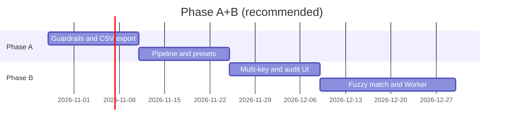

# CEO Review: Excelify Phase A+B

Generated by gstack `/plan-ceo-review` on 2026-10-28  
Design input: `docs/designs/excelify-reconciliation-phase-ab.md`  
Mode: **SELECTIVE EXPANSION** (A+B approved; no platform expansion)  
Depth: Implementation-ready priorities, capability-level contracts for B3 fuzzy

## Review facts

- Product: free beta, browser-local Excel/CSV tools, SEO-led acquisition.
- Shipped tools: preview, clean, compare, match, ageing.
- User decision: **Tier A polish + Tier B reconciliation depth** before auth/billing.
- Competitor: Excel + manual workflow, not other startups.

## NOT in scope

- Auth, cloud history, Stripe (Phase C).
- EvenTab / splitfair.
- Full pivot table / formula engine.
- Server-side file storage.

## What already exists

- Match/compare/clean engines with script tests (`scripts/test-*.ts`).
- SEO hubs for four tools; preview under-marketed.
- Privacy messaging and client-side parse path.
- Placeholder history + dormant Supabase middleware.

## Dream state delta

| Today | Dream (after A+B) |
|-------|-------------------|
| Disconnected tools | **Reconciliation pipeline** with handoff |
| Unlimited memory bomb | **Explicit limits** + path to Pro |
| XLSX export only | **CSV + XLSX** |
| Exact key match only | **Multi-key + optional fuzzy** |
| User re-enters columns each visit | **Saved presets** |

## Scope expansion decisions

| Item | Decision |
|------|----------|
| Fuzzy match | **Approved** — optional, off by default |
| Multi-key | **Approved** — B1 |
| Web Worker | **Approved** — required before limit increase |
| New SEO toolbox tools (split/filter) | **Deferred** — post Phase B retention check |
| Pro billing | **Deferred** — after preset re-use metric |

## Error & rescue registry (product-level)

| Failure | User sees | Rescue |
|---------|-----------|--------|
| File too large | Actionable cap message + link to trim tips | Do not parse |
| OOM / hang | "File exceeds safe row count" | Worker + row cap |
| 0% match | Audit explains blank keys / header mismatch | Suggest clean step + preset |
| Duplicate lookup keys | Warning list before export | Existing first/last behavior surfaced in UI |

## Failure modes registry

- **False confidence:** fuzzy match links wrong vendor — mitigate with confidence score + manual review column.
- **Scope creep:** building auth before presets — mitigate with feature flags and explicit Phase C gate.
- **SEO dilution:** too many thin tools — mitigate with one "reconciliation" solution page.

## Diagrams

### Dependency (product)

```mermaid
flowchart LR
  SEO[SEO /tools] --> App[/app dashboard]
  App --> Clean[Clean Data]
  Clean --> Match[Match and Bring]
  Match --> Export[CSV/XLSX Export]
  Presets[(localStorage presets)] --> Match
  Audit[Match Audit Panel] --> Match
```

### Wedge timeline



## Section summaries (1–10)

1. **Architecture** — OK to stay Next.js SPA-style; add session layer between tools, not new services. **WARNING:** wire or remove dead auth before marketing "secure workspace."
2. **Security** — OK client-only for free tier. **CRITICAL GAP:** no file size limits today (user self-DoS).
3. **Data** — No PII on server; presets in localStorage are user-controlled — document in privacy section when shipped.
4. **UX** — **CRITICAL GAP:** preview omitted from sidebar; pipeline must feel like one product, not four tabs.
5. **Testing** — **WARNING:** no CI; ship Vitest with Phase A1.
6. **Performance** — Full workbook in memory; Worker + caps required for B.
7. **Observability** — Use existing Vercel Analytics; add export + preset events before Phase B.
8. **Compliance** — Browser processing supports GDPR-friendly story; fuzzy match does not send data off-device.
9. **GTM** — Double down on solution page "reconcile two Excel files" linking into pipeline entry.
10. **Future** — Phase C: Pro = higher caps + cloud presets + batch; only if 7-day re-use ≥15%.

## Section 11: Design & UX

**UI scope:** Match audit panel, pipeline CTA on clean results, limit modals, preset picker.  
**OK:** Existing AppShell and tool cards — extend, don't redesign.  
Run `/design-review` before shipping fuzzy match UI (confidence scores need plain language).

## Stale diagram audit

N/A — first CEO review for this initiative.

## Completion summary

**Approved to build:** Phase A (all items) + Phase B (B1–B4) with fuzzy off by default and Worker before raising caps.  
**Rejected for now:** platform/auth, unrelated SEO tools, splitfair.  
**Gate to Phase C:** preset re-use + export metric hit.

## Unresolved decisions

1. Free tier byte cap (CEO recommends **15 MB** as default — user can override).
2. Whether pipeline entry is dashboard hero vs dedicated `/app/reconcile` route (eng review recommends dedicated route).

## Next steps — review chaining

- **Eng review:** complete (see `excelify-reconciliation-phase-ab-eng-review.md`).
- **Before code:** `/design-review` on audit panel + pipeline screens.
- **After A1:** `/review` on branch; `/qa` on staging URL for clean→match flow.
